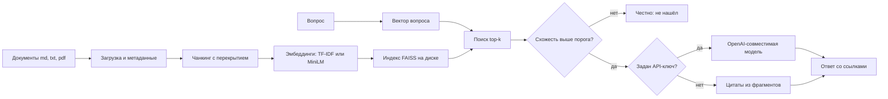

# Ассистент по вашим документам

Демо для услуги на Kwork: «AI-ассистент по вашим документам: ответы со ссылками».

Небольшой RAG на Python 3.11+. Берёт регламент, прайс, FAQ или PDF, режет текст на фрагменты, находит ближайшие к вопросу и отвечает цитатой со ссылкой вида `[файл, фрагмент]`. Если в файлах этого нет, пишет «Не нашёл ответа в загруженных документах» и ничего не выдумывает.

По умолчанию всё считается на вашей машине: TF-IDF (scikit-learn) и FAISS, без интернета и без API-ключа. Языковую модель можно подключить отдельно через любой OpenAI-совместимый адрес: OpenRouter, Groq или локальную Ollama. Hugging Face Spaces здесь нет. Мультиязычную модель эмбеддингов можно скачать пакетом `sentence-transformers`, но это отдельный режим, без него проект работает.

## Что это и бизнес-кейсы

- База знаний компании. Сотрудник спрашивает регламент и получает пункт документа, а не пересказ «по памяти».
- Продажи. Ответ по прайсу и условиям со ссылкой на конкретную строку.
- Поддержка. FAQ и инструкции: оператор видит фрагмент, который можно показать клиенту.
- Онбординг. Отпуск, командировки, испытательный срок — из одного и того же корпуса.
- Каркас внедрения. Понятный код без обязательного LangChain: его можно перенести на ваши файлы и вашу модель.

Это портфолио-демо, не юридическая консультация. На боевых документах порог схожести и промпт нужно откалибровать.

## Как устроен пайплайн



Что лежит в репозитории:

- `rag/loaders.py` — `.md`, `.txt` и постраничный `.pdf` через pypdf. У фрагмента сохраняются файл, страница и раздел.
- `rag/chunking.py` — абзацы не склеиваются; длинный абзац режется окном с перекрытием.
- `rag/embeddings.py` — TF-IDF с лёгкой обрезкой русских окончаний либо `paraphrase-multilingual-MiniLM-L12-v2`.
- `rag/store.py` — FAISS `IndexFlatIP`, сохранение и загрузка папки индекса.
- `rag/answer.py` — модель или экстрактивный фолбэк.
- `rag/cli.py`, `rag/api.py` — командная строка, `POST /ingest`, `POST /ask` и страница чата.

## Быстрый старт

Нужен Python 3.11 или новее.

```bash
python -m venv .venv
source .venv/bin/activate
pip install -r requirements.txt
cp .env.example .env

python -m rag ingest examples/docs
python -m rag ask "Сколько календарных дней составляет ежегодный оплачиваемый отпуск?"
```

Страница чата и HTTP API:

```bash
python -m rag serve
```

Откройте http://127.0.0.1:8000 , нажмите «Проиндексировать» (путь `examples/docs` уже подставлен) и задайте вопрос. Те же вызовы без браузера:

```bash
curl -s -X POST http://127.0.0.1:8000/ingest \
  -H 'Content-Type: application/json' \
  -d '{"path":"examples/docs"}'

curl -s -X POST http://127.0.0.1:8000/ask \
  -H 'Content-Type: application/json' \
  -d '{"question":"Какие суточные платят в командировке по России?"}'
```

Проверка тестов и стиля:

```bash
pip install -r requirements-dev.txt
ruff check .
pytest
```

Docker:

```bash
docker build -t simple-rag .
docker run --rm -p 8000:8000 simple-rag
```

В контейнере индекс пишется в `/data/rag_index`, демо-документы лежат в `/app/examples/docs`.

Семантические эмбеддинги (первый запуск скачает модель, нужен интернет; режим по умолчанию этого не делает):

```bash
pip install -r requirements-optional.txt
python -m rag ingest examples/docs --embedder sbert
```

## Примеры запросов и ответов

Корпус — `examples/docs`: регламент, прайс и FAQ вымышленной компании «Северный Контур». Ключ модели не задан, поэтому ответ собран из цитат. Номера фрагментов относятся к настройкам по умолчанию (`RAG_CHUNK_SIZE=800`, `RAG_CHUNK_OVERLAP=120`).

Вопрос:

> Сколько календарных дней составляет ежегодный оплачиваемый отпуск и за сколько дней подаётся заявление?

Ответ:

```text
Ответ собран из найденных фрагментов:

«Ежегодный оплачиваемый отпуск составляет 28 календарных дней. Заявление на отпуск подаётся не позднее чем за 14 календарных дней до даты начала.» [reglament.md, раздел «Отпуск», фрагмент 15]

«Напишите заявление на имя руководителя, укажите даты начала и окончания и передайте его в отдел кадров не позднее чем за 14 календарных дней. Статус заявления можно уточнить у кадрового специалиста Анны Соколовой.» [faq.md, раздел «Как заказать отпуск», фрагмент 1]
```

Вопрос:

> Сколько стоит чат-бот с ответами по документам и какой срок выполнения?

Ответ:

```text
«Чат-бот с ответами по документам компании — 120 000 рублей. Срок выполнения — 15 рабочих дней.» [price.txt, фрагмент 9]
```

Вопрос:

> Какие суточные платят в командировке по России?

Ответ:

```text
«Командировка оформляется приказом. Суточные составляют 1500 рублей в сутки по России и 3500 рублей в сутки за рубежом.» [reglament.md, раздел «Командировки», фрагмент 18]
```

Вопрос:

> Какая скидка постоянному клиенту и с какого проекта она действует?

Ответ:

```text
«Скидка постоянному клиенту составляет 10 процентов и применяется со второго проекта.» [faq.md, раздел «Где посмотреть цены», фрагмент 2]
```

Вопрос, которого нет в документах:

> Какой сегодня курс биткоина?

Ответ:

```text
Не нашёл ответа в загруженных документах.
```

Так же ассистент отвечает на «Как зовут генерального директора компании?»: в файлах нет ни курса, ни фамилии директора, поэтому ссылка на случайный фрагмент не подставляется.

Ещё готовые формулировки лежат в `examples/qa.md`.

## Локальная модель через Ollama

Ollama говорит на том же протоколе, что OpenAI. Пустой `OPENAI_API_KEY` специально включает фолбэк и модель не вызывает, поэтому для локальной модели ключ нужен любой непустой.

```bash
ollama pull llama3.1
ollama serve
```

В `.env`:

```text
OPENAI_BASE_URL=http://localhost:11434/v1
OPENAI_API_KEY=ollama
OPENAI_MODEL=llama3.1
```

Индекс заново собирать не нужно: модель только формулирует ответ по уже найденным фрагментам. В промпте ей сказано не добавлять факты вне контекста и сохранять ссылки вида `[reglament.md, фрагмент 15]`. Если сервер модели не ответил, срабатывает тот же экстрактивный фолбэк.

OpenRouter и Groq подключаются так же, меняются только адрес, ключ и имя модели. Заготовки лежат в `.env.example`.

## Ограничения и как масштабировать

- TF-IDF сравнивает слова, а не смысл. Вопрос другими словами может не найтись. Для перефразирования есть режим `--embedder sbert`.
- Порог `RAG_MIN_SCORE` по умолчанию `0.25`. Ниже — в ответ попадает чужой фрагмент, выше — честное «не нашёл» даже там, где ответ был. На своём корпусе порог стоит подвинуть.
- Скан PDF без текстового слоя не читается: его нужно распознать до загрузки.
- Каждый `ingest` пересобирает индекс целиком. Для папки демо-документов это проще, чем точечные обновления.
- API без авторизации и умеет читать путь на диске сервера. Это локальное демо, его не стоит выставлять в интернет как есть.
- Экстрактивный режим показывает одно-два предложения фрагмента. Связный ответ из нескольких кусков получается, когда подключена модель.

Если документов станет много:

- Хранилище. Chroma или Qdrant вместо одного файла FAISS: фильтры по метаданным, несколько коллекций, общая работа нескольких процессов.
- Реранкер. Сначала быстрый поиск top-50, затем cross-encoder (например, bge-reranker) и в модель только top-5. На перефразированных вопросах это даёт больше, чем смена одного лишь векторного индекса.
- Нарезка под документ. Пункты договора и строки прайса лучше резать по структуре, а не только по абзацам.
- Разбор ошибок. Сохранять вопрос, выбранные фрагменты и оценку схожести, чтобы порог настраивался по реальным промахам, а не на глаз.

## Заказать

Нужен такой ассистент на ваших регламентах, прайсе, базе знаний или договорах: со ссылкой на фрагмент и с честным «не нашёл», когда факта в файлах нет.

[Заказать на Kwork](https://kwork.ru/user/karagodini)

## Лицензия

MIT. Текст — в файле [LICENSE](LICENSE).
